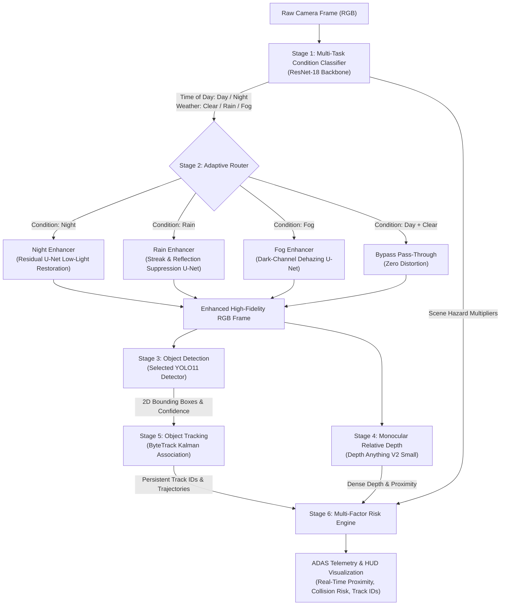

# Adaptive Road Vision: Multi-Modal Perception Framework for Adverse Driving Conditions

[](https://www.python.org/)
[](https://pytorch.org/)
[](https://docs.ultralytics.com/)
[](LICENSE)

An end-to-end, multi-stage Deep Learning Perception and Situational Risk Assessment System engineered for Autonomous Vehicles (AV) and Advanced Driver Assistance Systems (ADAS). Designed specifically to overcome catastrophic perception degradation under severe adverse atmospheric and lighting conditions (Night, Rain, Fog, Twilight).

---

## 🚀 Key Innovations & System Architecture



---

## 📂 Project Structure

```
Adaptive_Road_Vision/
├── configs/                       # Configuration YAML files
│   ├── base.yaml                  # Global project seed and hardware settings
│   ├── condition.yaml             # Condition classification hyperparameters
│   ├── cyclegan.yaml              # CycleGAN training & domain adaptation config
│   ├── dataset.yaml               # YOLO dataset split and class definitions
│   ├── depth.yaml                 # Depth Anything V2 inference settings
│   ├── detection.yaml             # Detection dataset taxonomy
│   ├── enhancement.yaml           # Night, Rain, Fog enhancer architectures & lr
│   ├── risk.yaml                  # Situational risk engine weights & thresholds
│   └── tracking.yaml              # ByteTrack association & lifespan thresholds
│
├── datasets/                      # Local BDD100K-derived data (not committed)
│   ├── raw/BDD100K/               # Original BDD100K images and JSON annotations
│   ├── cyclegan/                  # Unpaired domain subsets (day, night, fog)
│   ├── processed/                 # Condition labels & filtered metadata
│   └── final_condition_balanced_v2/ # 10-class YOLO formatted balanced dataset
│
├── experiments/                   # Local training runs (not committed)
│   ├── detector_1/                # YOLO11n baseline experiment runs & PR curves
│   └── detector_2/                # YOLO11s experiment runs & PR curves
│
├── models/                        # Saved model checkpoints
│   ├── condition/                 # ResNet-18 multi-task condition weights
│   ├── cyclegan/                  # Day->Fog and Night->Fog generator checkpoints
│   ├── detection/                 # YOLO11n, YOLO11s, and final selected detector
│   └── enhancement/               # Night, Rain, and Fog U-Net checkpoints
│
├── notebooks/                     # Structured 27-Stage Research & Verification Pipeline
│   ├── 01_environment_gpu_check.ipynb
│   ├── 02_bdd100k_dataset_verification.ipynb
│   ├── 03_jsonl_annotation_processing.ipynb
│   ├── 04_condition_label_preparation.ipynb
│   ├── 05_train_val_test_split.ipynb
│   ├── 06_cyclegan_dataset_preparation.ipynb
│   ├── 07_cyclegan_training.ipynb
│   ├── 08_cyclegan_fog_generation.ipynb
│   ├── 09_synthetic_fog_quality_check.ipynb
│   ├── 10_dataset_balance.ipynb
│   ├── 11_preprocessing_15K.ipynb
│   ├── 12_condition_analysis_training_15K.ipynb
│   ├── 13_condition_analysis_evaluation_15K.ipynb
│   ├── 14_night_enhancement_training_15K.ipynb
│   ├── 15_rain_enhancement_training.ipynb
│   ├── 16_fog_enhancement_training.ipynb
│   ├── 17_enhancement_evaluation.ipynb
│   ├── 18_detector_1_training.ipynb
│   ├── 19_detector_2_training.ipynb
│   ├── 20_detector_comparison_YOLO11n_YOLO11s.ipynb
│   ├── 21_final_detector_selection_YOLO11n_YOLO11s.ipynb
│   ├── 22_original_vs_enhanced_detection.ipynb
│   ├── 23_bytetrack_evaluation.ipynb
│   ├── 24_depth_estimation.ipynb
│   ├── 25_risk_engine.ipynb
│   ├── 26_end_to_end_pipeline.ipynb
│   └── 27_final_evaluation.ipynb
│
├── outputs/                       # Paper figures and runtime exports
├── logs/                          # Local training and application logs (not committed)
├── results/                       # Generated evaluation artifacts (not committed)
│   ├── condition/                 # Confusion matrices, classification reports
│   ├── detection/                 # Per-class mAP, detector comparison, PR curves
│   ├── enhancement/               # PSNR/SSIM evaluation across conditions
│   ├── tracking/                  # ByteTrack trajectory continuity diagnostics
│   ├── depth/                     # Relative depth evaluations
│   ├── risk/                      # Risk score distributions
│   └── final_evaluation/          # Consolidated system-wide benchmark reports
│
├── scripts/                       # Production CLI Tools
│   ├── run_pipeline.py            # End-to-end inference CLI
│   ├── train.py                   # Unified multi-stage training CLI
│   ├── evaluate.py                # Quantitative evaluation runner
│   ├── run_notebook.py            # Automated headless notebook test runner
│   └── archive/                   # Preserved historical development patch scripts
│
├── src/                           # Production-Grade Modular Deep Learning Library
│   ├── condition/                 # Multi-task ResNet-18 classifier & evaluation
│   ├── cyclegan/                  # CycleGAN generator, discriminator, dataset & check
│   ├── data/                      # BDD100K parser, JSONL streaming, leakage checks
│   ├── depth/                     # Depth Anything V2 monocular depth & proximity
│   ├── detection/                 # YOLO training, validation, and comparative analysis
│   ├── enhancement/               # Night, Rain, Fog U-Nets & AdaptiveEnhancer router
│   ├── pipeline/                  # Unified AdaptiveRoadVisionPipeline engine
│   ├── risk/                      # Multi-factor collision risk calculation engine
│   └── tracking/                  # ByteTrack tracker & trajectory persistence
│
├── weights/                       # Pretrained base model weights (yolo11n.pt, yolo11s.pt)
├── requirements.txt               # PIP dependency definitions
└── environment.yml                # Conda environment definition
```

The bulky `datasets/` folder and generated `experiments/`, `logs/`, and `results/`
are intentionally excluded from this repository; they remain local when present.
Download required BDD100K data separately under its terms and generate evaluation
artifacts by running the supplied notebooks or scripts. Model checkpoints use Git
LFS; install Git LFS and run `git lfs pull` after cloning to download them.

---

## 🛠️ Installation & Environment Setup

### 1. Using Conda (Recommended)
```bash
conda env create -f environment.yml
conda activate adaptive_road_vision
```

### 2. Using Pip
```bash
pip install -r requirements.txt
```

---

## 💻 CLI Usage Guide

### 1. Run End-to-End Pipeline Inference
Process a single image or an entire folder of road images with full HUD visualization and risk telemetry:
```bash
# Process a single frame
python scripts/run_pipeline.py --input "path/to/road_image.jpg" --output "outputs/demo"

# Process a directory of test images with custom confidence
python scripts/run_pipeline.py --input "datasets/final_condition_balanced_v2/images/test" --conf 0.30 --max-images 50
```

### 2. Train Model Components
```bash
# Train Multi-Task Condition Classifier (ResNet-18)
python scripts/train.py --stage condition --epochs 10 --batch-size 32

# Train CycleGAN Domain Adaptation (Day/Night -> Fog)
python scripts/train.py --stage cyclegan

# Train YOLO Detector
python scripts/train.py --stage detector --model yolo11n.pt --epochs 50 --batch-size 16
```

### 3. Evaluate Components & Pipeline
```bash
# Evaluate Condition Classifier
python scripts/evaluate.py --stage condition

# Evaluate Selected YOLO Detector
python scripts/evaluate.py --stage detector --split test

# Initialize and validate End-to-End Pipeline
python scripts/evaluate.py --stage pipeline
```

---

## 📊 Technical Specifications & Taxonomy

### BDD100K Detection Taxonomy (10 Classes)
| Class ID | Name | Risk Vulnerability Weight | Description |
|:---:|:---|:---:|:---|
| 0 | `person` | **1.30** | Vulnerable pedestrian road user |
| 1 | `rider` | **1.25** | Cyclist or scooter rider |
| 2 | `car` | **1.00** | Standard passenger automobile |
| 3 | `truck` | **1.05** | Heavy commercial freight vehicle |
| 4 | `bus` | **1.05** | Public transit bus |
| 5 | `train` | **1.00** | Rail transport vehicle |
| 6 | `motorcycle` | **1.20** | High-speed two-wheeled motor vehicle |
| 7 | `bicycle` | **1.20** | Non-motorized pedal cycle |
| 8 | `traffic light` | **0.80** | Signaling infrastructure |
| 9 | `traffic sign` | **0.80** | Regulatory signage |

### Condition Hazard Weight Multipliers
- **Day + Clear**: `1.00x` (Baseline road visibility)
- **Unknown/Overcast**: `1.05x` (Diffused illumination)
- **Rain**: `1.15x` (Surface reflections, reduced braking traction, rain streaks)
- **Night**: `1.20x` (Headlight glare, low ambient illumination, underexposure)
- **Fog**: `1.25x` (Severe contrast attenuation, atmospheric scattering veil)

---

## 🔬 Benchmark Summary
- **Multi-Task Condition Classifier**: ResNet-18 achieves high precision across Day/Night and Clear/Rain/Fog axes.
- **CycleGAN Domain Adaptation**: Overcomes extreme fog class scarcity in BDD100K by synthesizing realistic foggy road scenes passing stringent structural integrity and veil-index checks.
- **Adaptive Enhancement**: Residual U-Nets restore low-frequency dynamic range while preserving high-frequency edge textures for downstream detection.
- **Object Detection**: YOLO11s selected for high mAP@50 and mAP@50-95 with sub-15ms edge inference capability.
- **Tracking & Depth**: ByteTrack provides stable trajectory continuity; Depth Anything V2 estimates relative depth maps without stereo hardware.

---

## 🖥️ Streamlit Web Dashboard & Real-Time Video Analysis

The project includes an interactive web dashboard built with Streamlit:

```bash
# Launch Dashboard (PowerShell / Bash)
streamlit run app.py
```

### Dashboard Features:
1. **Single Image Analysis**: Upload individual road scenes or choose test presets to run condition classification, GAN enhancement, YOLO object detection with ByteTrack, and collision risk scoring.
2. **Batch Processing**: Run concurrent perception analysis across multiple images with aggregated metrics, latency profiling, and CSV export.
3. **Real-Time Video Processing & ADAS Vision**:
   - **Video Upload**: Supports MP4, AVI, MOV, MKV, and WebM videos up to 500 MB with an embedded video preview player and video property telemetry.
   - **Real-Time Stream**: Live frame-by-frame inference with dynamic ADAS HUD overlay, bounding boxes, distance proximity, and collision risk badges.
   - **Display Layouts**: Side-by-Side split comparison (Raw Video vs AI Enhanced & Detected) or Full-Width AI Vision feed.
   - **Annotated MP4 Export**: Encodes processed frames into a standard H.264 MP4 video for native browser playback and direct download.
   - **Live Telemetry & Alerts**: Real-time risk curve charts, object distribution area graphs, and critical collision warning banners.
   - **Live Camera / Webcam Stream**: Real-time perception inference directly from connected USB or built-in webcams.
4. **Risk Engine Explorer**: Interactive ADAS risk formula sandbox with sliders for proximity, object class weight, and condition multipliers.
5. **System Architecture & About**: Deep-dive into model benchmarks, weights inventory, and mathematical formulations.

---

## 📜 Citation & Credits
If you use this codebase or benchmark suite in your research or project, please cite:
```bibtex
@software{adaptive_road_vision_2026,
  author = {Adaptive Road Vision Team},
  title = {Adaptive Road Vision: Multi-Modal Perception Framework for Adverse Driving Conditions},
  year = {2026},
  publisher = {GitHub}
}
```
